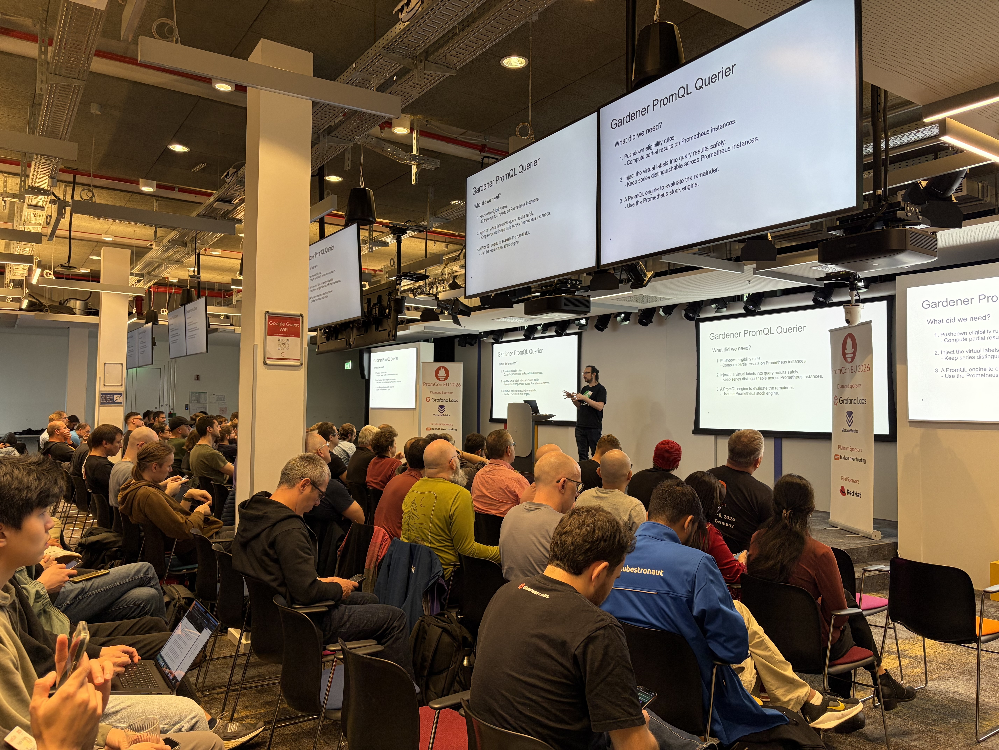

# PromCon EU 2026 Highlights

PromCon EU 2026 took place on October 7th and 8th in Munich. As in previous years, the single-track conference brought together Prometheus developers and users to discuss the latest developments in the ecosystem. This year was particularly special for us because, for the first time, we had our own talk at the conference, presenting our work on global querying for Prometheus in Gardener.

## Global Querying in Gardener

If you have worked with Gardener's monitoring stack, you are probably familiar with our Prometheus setup. We run Prometheus instances on every level of Gardener's hierarchical architecture. Starting at the top, there is the garden and longterm Prometheus in the runtime cluster, followed by a cache, aggregate and seed Prometheus per seed, and finally one shoot Prometheus per shoot. Currently, Gardener uses [hierarchical federation](https://prometheus.io/docs/prometheus/latest/federation/#hierarchical-federation) to provide a global view across multiple Prometheus instances. Such a setup, however, forces us to decide upfront which metrics and aggregations to carry up the tree. Once we have made that decision, we are stuck with it.

We have started to build the Gardener [PromQL Querier](https://github.com/gardener/promql-querier), a stateless proxy that makes the entire fleet appear as a single Prometheus instance at query time. Aggregations and a few other expressions are pushed down to each downstream and partial results are merged locally, all through the standard Prometheus HTTP API and the stock Prometheus engine. This makes the Gardener PromQL Querier efficient because it delegates to every Prometheus instance its share of the work, which spreads the load throughout the hierarchy. Only the pre-computed partial results are pulled up the tree. Unlike federation, nothing has to be decided upfront, since the proxy evaluates whatever query it receives.

We kicked off this endeavour in the summer of 2026 and the project is still in its infancy, but we are looking forward to continuing the work in 2027. You can watch the talk here: [A Prometheus-Native Approach to Global Querying](https://www.youtube.com/watch?v=3iCubwc19Gk)

## Migration to Native Histograms

Native histograms remained one of the main topics at this year's edition. One of the recurring pain points of native histograms is the migration from classic histograms. Prometheus supports converting classic histograms into NHCB at scrape time, but queries in existing dashboards and alerts also need to be migrated. Bartłomiej Płotka and Raphaël Bizos proposed a query-time conversion where the engine translates NHCB back into classic histogram format, so that the storage can migrate to NHCB form while dashboards and alerts keep working unchanged.

## Delta Temporality

Owen Williams presented his work on native delta counters, a new counter type in Prometheus. A cumulative counter reports the running total so far, while a delta counter reports how much changed since the previous sample. Like any other type, deltas can be used in push or pull models, but they make more sense in a push model where the producer knows when the last sample was sent and can emit an exact delta.

## Fighting Cardinality

On the ingestion side, Walther Lee showed how materialized metrics aggregate series as data is ingested to produce metrics with lower cardinality. The work currently lives in a Prometheus fork, with an upstream proposal planned, and the next step is to drop the raw full-dimensionality data and keep only the aggregates. This sounds promising for Gardener, where Prometheus instances in very large seeds or shoots can struggle to honor their intended 30-day retention because high-cardinality metrics fill the disk long before that.

Roman Khavronenko and Langson Zhang approached cardinality by measuring it rather than reducing it. Their estimator approximates each metric's cardinality in real time, as the data is ingested rather than by querying the TSDB. Estimation results are exposed as Prometheus metrics themselves that can be scraped to create alerts on cardinality spikes.

## Sharing Exporters with OpenTelemetry

Interoperability between OpenTelemetry and Prometheus continued to be a topic. The two ecosystems have been duplicating each other's work for years. Where there is a Prometheus exporter, there is likely an OpenTelemetry receiver for the same metrics, and vice versa. Arthur Sens and Kyle Eckhart proposed a way to build Prometheus exporters so that the same code can run either as a standalone exporter or embedded in an OpenTelemetry Collector, letting the two communities share code instead of maintaining overlapping exporters and receivers. The approach is early enough that only a handful of exporters have been adapted so far.

## Alertmanager Is Alive Again

Guido Trotter, Ethan Hunter, Solomon Jacobs, and Siavash Safi introduced themselves as the new maintainer team for Alertmanager. The project had slowed down in recent years, and the need to revamp it was an outcome of PromCon EU 2025. The new team has fixed the most pressing issues and announced plans to take the project further.

## Until Next Year

PromCon continues to be one of the most valuable conferences for anyone working with Prometheus at scale. Presenting our own work this year was a great experience, and we are looking forward to continuing to develop the Gardener PromQL Querier. See you in 2027.
